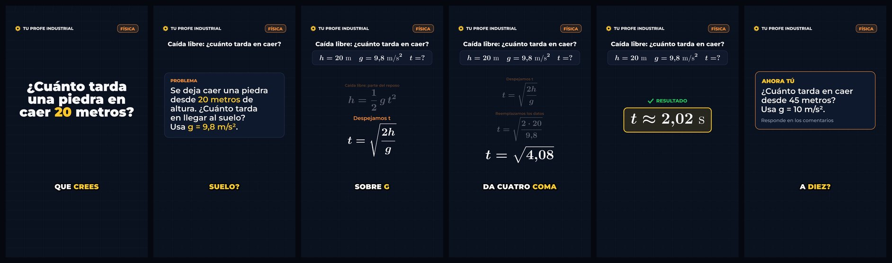

# 🎬 tuprofeindustrial-videos · Motor de video (Sistema 2)

Convierte un ejercicio de **Matemática, Física o Ingeniería** escrito en un archivo de texto (un *guion*) en un
**video vertical 9:16** listo para TikTok, Reels y Shorts:

- 🧮 **Animaciones con Manim**: las fórmulas (LaTeX) se transforman paso a paso, como en una pizarra.
- 🗣️ **Voz sintética chilena** (manim-voiceover + voces neurales `es-CL`), sincronizada con cada animación.
- 💬 **Subtítulos estilo CapCut**: palabras grandes y la que suena en amarillo (FFmpeg; Whisper cuando hace falta).

> Es el **Sistema 2** del ecosistema Tu Profe Industrial y es **100 % independiente de la web**: este repo es solo Python.



```
guion .yaml ─► ./tpi revisar ─► Manim + voz ─► subtítulos ─► FFmpeg ─► salida/…/video.mp4 (1080×1920)
```

---

## 1. Instalación (una sola vez, en tu Mac)

Abre la app **Terminal** y copia/pega estos bloques, uno a la vez.

**a) Descargar el repo**

```bash
cd ~/Downloads
git clone https://github.com/paillamilm-blip/tuprofeindustrial-videos.git
cd tuprofeindustrial-videos
```

**b) Instalar todo** (Homebrew, FFmpeg completo, LaTeX, Python 3.12, Manim, voz y Whisper)

```bash
./scripts/instalar_mac.sh
```

- Tarda entre 10 y 25 minutos la primera vez. Te pedirá **tu contraseña del Mac** (al instalar LaTeX).
- Puedes repetirlo cuando quieras: lo que ya está instalado se salta.
- Al final ejecuta `./tpi doctor`, que revisa todo. Si algo sale con ❌, sigue la flecha amarilla.

## 2. Tu primer video

```bash
cd ~/Downloads/tuprofeindustrial-videos
./tpi crear guiones/ejemplos/fisica_caida_libre.yaml --borrador --abrir
```

`--borrador` hace una versión rápida en calidad baja para revisar. Cuando te guste, crea la versión final:

```bash
./tpi crear guiones/ejemplos/fisica_caida_libre.yaml --abrir
```

El video queda en `salida/fisica-caida-libre/fisica-caida-libre.mp4`, junto a un `.srt` con subtítulos
para subir a YouTube.

## 3. El día a día: de un enunciado a un video

1. **Escribe el guion.** Dos caminos:
   - **Con Kiro (recomendado):** pásale el enunciado en el chat; Kiro escribe el guion con la solución paso a
     paso y te lo entrega en un Pull Request. Luego lo bajas con `git pull`.
   - **Tú mismo:** crea uno desde la plantilla y ábrelo con TextEdit:
     ```bash
     ./tpi nuevo plano_inclinado --materia fisica
     open -e guiones/plano_inclinado.yaml
     ```
     (En TextEdit desactiva *Edición → Sustituciones → Comillas inteligentes*.)
2. **Revísalo** (duración, gancho, frases largas, símbolos que la voz leería mal):
   ```bash
   ./tpi revisar guiones/plano_inclinado.yaml
   ```
3. **Crea el borrador**, míralo, ajusta el guion y repite. Al final, crea la versión final (sin `--borrador`).

Cómo escribir un buen guion (con ejemplos de LaTeX): **[docs/GUIA_GUIONES.md](docs/GUIA_GUIONES.md)**.

## 4. Comandos

| Comando | Qué hace |
|---|---|
| `./tpi doctor` | Revisa que todo esté instalado (agrega `--red` para probar también la voz) |
| `./tpi nuevo NOMBRE --materia fisica` | Crea `guiones/NOMBRE.yaml` desde la plantilla |
| `./tpi revisar GUION.yaml` | Revisa el guion sin crear el video |
| `./tpi crear GUION.yaml` | Crea el video final (1080×1920, 30 fps) |
| `./tpi crear GUION.yaml --borrador` | Versión rápida para revisar (540×960) |
| `./tpi crear GUION.yaml --voz es-CL-CatalinaNeural` | Otra voz (ver `./tpi voces`) |
| `./tpi crear GUION.yaml --voz silencio` | Sin voz y sin internet: para revisar el diseño |
| `./tpi crear GUION.yaml --sin-subtitulos` | Sin subtítulos quemados |
| `./tpi subtitular VIDEO.mp4` | Subtítulos estilo CapCut para **cualquier** video (por ejemplo, uno grabado por ti) |
| `./tpi voces` | Lista las voces en español |

Agrega `--abrir` a `crear` o `subtitular` para que el video se abra solo al terminar.

## 5. Personalizar la marca

Edita **`marca.yaml`**: nombre, usuario (@), colores, voz por defecto, frase de cierre y estilo de los
subtítulos (fuente, tamaño, color de la palabra activa, altura). Todo es opcional.

## 6. Dónde queda cada cosa

```
guiones/ejemplos/     3 guiones de ejemplo (física, matemática, ingeniería)
guiones/              tus guiones
marca.yaml            identidad visual y sonora
salida/               videos generados (no se suben a GitHub)
src/tpi_videos/       el motor (Python)
docs/                 guía de guiones y plan del proyecto
scripts/              instalador para Mac
tpi                   lanzador de comandos
```

## 7. Problemas frecuentes

| Mensaje | Solución |
|---|---|
| `zsh: permission denied: ./tpi` | `chmod +x tpi scripts/instalar_mac.sh` |
| `Falta LaTeX` | Cierra la Terminal, ábrela de nuevo y ejecuta `./scripts/instalar_mac.sh` |
| `Tu FFmpeg no puede dibujar subtítulos` | `brew install ffmpeg-full` (el `ffmpeg` normal de Homebrew ya no trae libass) |
| `No pude generar la voz` | Revisa internet. Alternativas: `--voz gtts` o `--voz silencio` |
| `parece que la fórmula está entre comillas dobles` | En el guion, escribe las fórmulas entre comillas **simples**: `tex: 'h = \frac{1}{2} g t^2'` |
| `No pude dibujar la fórmula` | Revisa el LaTeX (llaves `{ }`, comandos con `\`). Pruébala en overleaf.com |
| Algo inesperado | Repite con `./tpi --debug crear …` y comparte el mensaje con Kiro |

## 8. Bueno saber

- **Tiempos** (medidos en las pruebas del sandbox, Linux de 8 núcleos, para ~1 minuto de video): borrador
  ~15–20 s, final ~35–40 s. En tu Mac pueden variar.
- **Voz:** por defecto usa las voces neurales de Microsoft vía `edge-tts` (gratis, requiere internet). Es un
  servicio no oficial: si el canal crece o se monetiza, conviene pasar a Azure Speech, que tiene las mismas
  voces chilenas con licencia comercial (ver [docs/PLAN.md](docs/PLAN.md)).
- **Whisper** se usa cuando la voz no trae marcas de tiempo (`--voz gtts`, `tpi subtitular`). La primera vez
  descarga su modelo (~140 MB).
- **Fuente:** Montserrat, licencia SIL Open Font License (`src/tpi_videos/assets/fuentes/OFL.txt`).
