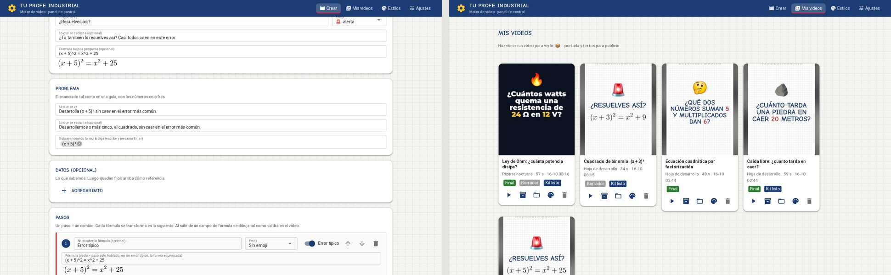
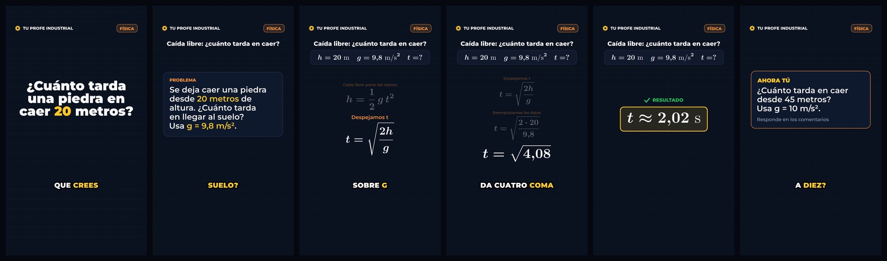

# 🎬 tuprofeindustrial-videos · Motor de video (Sistema 2)

Convierte un ejercicio de **Matemática, Física o Ingeniería** escrito en un archivo de texto (un *guion*) en un
**video vertical 9:16** listo para TikTok, Reels y Shorts:

- 🎛️ **Panel de control en tu navegador**: del enunciado (o una foto) al video y al kit para publicar, sin
  usar la Terminal. Funciona solo en tu Mac.
- 📓 **Tu estilo «Hoja de desarrollo»**: hoja cuadriculada sobre fondo difuminado, títulos de cómic técnico
  (Comic Neue) que se escriben como con plumón. El estilo original «Pizarra nocturna» sigue disponible.
- 🧮 **Animaciones con Manim**: las fórmulas (LaTeX) se transforman paso a paso, como en una pizarra.
- ✏️ **Dibujos que se trazan solos**: un paso puede llevar su **gráfico de función** (con raíces y vértice
  marcados), su **diagrama de fuerzas** (bloque o bola, con plano inclinado) o su **circuito** (serie o
  paralelo). Se dibujan en el pie de la hoja mientras suena ese paso. Ejemplo: `guiones/ejemplos/visuales_tres_tipos.yaml`.
- 🤯 **Emojis 3D y «error típico»**: emojis que aparecen con un salto y un paso que muestra la forma
  equivocada y la tacha con una ✗ roja («¿Resuelves así?»).
- 🗣️ **Voz sintética chilena** (manim-voiceover + voces neurales `es-CL`), sincronizada con cada animación.
- 💬 **Subtítulos estilo CapCut**: letra Bangers, pocas palabras y la que suena en amarillo (FFmpeg; Whisper
  cuando hace falta).
- 📦 **Kit de publicación**: portada y, con IA, título, descripción y hashtags para cada red.

> Es el **Sistema 2** del ecosistema Tu Profe Industrial y es **100 % independiente de la web**: este repo es solo Python.


```
guion .yaml ─► ./tpi revisar ─► Manim + voz ─► subtítulos ─► FFmpeg ─► salida/…/video.mp4 (1080×1920)
```

---

## 1. Instalación (una sola vez, en tu Mac)

Abre la app **Terminal** y copia/pega estos bloques, uno a la vez.

**a) Descargar el repo**

```bash
cd ~/Downloads
git clone https://github.com/paillamilm-blip/tuprofeindustrial-videos.git
cd tuprofeindustrial-videos
```

**b) Instalar todo** (Homebrew, FFmpeg completo, LaTeX, Python 3.12, Manim, voz, Whisper y el panel)

```bash
./scripts/instalar_mac.sh
```

- Tarda entre 10 y 25 minutos la primera vez. Te pedirá **tu contraseña del Mac** (al instalar LaTeX).
- Puedes repetirlo cuando quieras: lo que ya está instalado se salta.
- Al final ejecuta `./tpi doctor`, que revisa todo. Si algo sale con ❌, sigue la flecha amarilla.
- Si todo está bien, deja en tu Escritorio el ícono **«Panel Tu Profe Industrial»** (la primera vez se abre
  Finder para mostrártelo).

## 2. El panel de control (lo más fácil)


Abre el panel con **doble clic en el ícono «Panel Tu Profe Industrial»** de tu Escritorio (el cuadrado azul con
el engranaje amarillo), o desde la Terminal:

```bash
cd ~/Downloads/tuprofeindustrial-videos && ./tpi panel
```

¿No encuentras el ícono? `./tpi icono` lo crea de nuevo y abre Finder con el ícono marcado. Tip: arrástralo al
lado derecho del Dock (junto a la papelera) y lo abres con un clic.

Se abre en tu navegador, en `http://127.0.0.1:8765`. **Solo funciona en tu Mac**: nadie más puede entrar,
ni siquiera desde tu WiFi. Deja abierta la ventana de la Terminal mientras lo usas; para cerrar el panel,
cierra esa ventana (o presiona `Control + C`).



| Pestaña | Para qué sirve |
|---|---|
| **Crear** | 4 pestañas: **Ideas** (escribes un tema, la IA te propone 3 videos y tú eliges uno; el motor hace todo lo demás), **Escribir con IA** (el enunciado, una foto o un PDF → el guion), **Abrir un guion** y **Empezar en blanco**. El guion se edita en tarjetas: lo que se ve, lo que se escucha, emojis y «error típico», con cada fórmula dibujada tal como saldrá en el video. Luego eliges el estilo y creas el borrador o el video final: verás una barra de avance y el video aparece ahí mismo. |
| **Mis videos** | Ver tus videos, mostrarlos en Finder, rehacerlos con otro estilo, borrarlos y abrir el 📦 **kit de publicación**. |
| **Estilos** | Ver una vista previa de cada estilo y elegir el que usas siempre. Para cambiar colores, letras, el fondo (¡también con tu foto!), la hoja o los subtítulos, duplica un estilo y edita la copia. |
| **Ajustes** | Tu clave de Gemini, tu marca, la voz (con muestra ▶), tus stickers y el diagnóstico. |

**📦 Kit de publicación:** la **portada** (el cuadro del gancho, en PNG) y, con IA, el **título, la descripción
y los hashtags** para YouTube Shorts, TikTok e Instagram Reels, con botones para copiar. Sin clave de Gemini se
arma con una plantilla. Desde la Terminal: `./tpi publicar salida/mi-video/mi-video.mp4`.

Todo lo que hace el panel lo hacen los mismos comandos `./tpi` de las secciones siguientes: puedes usar los dos.

## 3. Tu primer video desde la Terminal

```bash
cd ~/Downloads/tuprofeindustrial-videos
./tpi crear guiones/ejemplos/fisica_caida_libre.yaml --borrador --abrir
```

`--borrador` hace una versión rápida en calidad baja para revisar. Cuando te guste, crea la versión final:

```bash
./tpi crear guiones/ejemplos/fisica_caida_libre.yaml --abrir
```

El video queda en `salida/fisica-caida-libre/fisica-caida-libre.mp4`, junto a un `.srt` con subtítulos
para subir a YouTube.

## 4. El día a día: de un enunciado a un video

1. **Consigue el guion.** Cuatro caminos:
   - **En el panel (recomendado):** pestaña **Crear** → «Escribir con IA» (ver sección 2).
   - **Con IA, en un comando:** pásale el enunciado escrito, una **foto** o un **PDF** (ver sección 5). La IA
     resuelve el ejercicio y escribe el guion; con `--crear` también hace el borrador.
   - **Con Kiro:** pásale el enunciado en el chat y te entrega el guion en un Pull Request.
   - **Tú mismo:** crea uno desde la plantilla y ábrelo con TextEdit:
     ```bash
     ./tpi nuevo plano_inclinado --materia fisica
     open -e guiones/plano_inclinado.yaml
     ```
     (En TextEdit desactiva *Edición → Sustituciones → Comillas inteligentes*.)
2. **Revísalo** (duración, gancho, frases largas, símbolos que la voz leería mal):
   ```bash
   ./tpi revisar guiones/plano_inclinado.yaml
   ```
3. **Crea el borrador**, míralo, ajusta el guion y repite. Al final, crea la versión final (sin `--borrador`).

Cómo escribir un buen guion (con ejemplos de LaTeX): **[docs/GUIA_GUIONES.md](docs/GUIA_GUIONES.md)**.

### Emojis y «error típico» en el guion

```yaml
gancho:
  texto: "¿Resuelves así?"
  tex: '(x + 5)^2 = x^2 + 25'     # una fórmula bajo la pregunta (opcional)
  emoji: "🚨"                      # emoji 3D que aparece con un salto (opcional)

pasos:
  - nota: "Error típico"
    tex: '(x + 5)^2 = x^2 + 25'
    voz: "El error es elevar cada término por separado."
    error: true                    # se tacha con una ✗ roja; el paso siguiente muestra la forma correcta
```

- Los emojis van en su campo `emoji:` (en el gancho, los pasos, el resultado, la verificación, el reto y el
  cierre), nunca dentro de `texto` o `voz`. Lista: `./tpi emojis`.
- **Tus propias imágenes:** guarda un PNG con fondo transparente en `mis_ajustes/stickers/` (por ejemplo
  `mascota.png`, o súbelo en el panel: Ajustes → Tus stickers) y escribe `emoji: mascota`. En el `cierre`
  reemplaza al engranaje de la marca.
- Ejemplo completo: `guiones/ejemplos/matematica_error_binomio.yaml`. La IA (`./tpi redactar`) también
  elige emojis y agrega un error típico cuando existe uno famoso — y un dibujo (gráfico, fuerzas o circuito)
  cuando el ejercicio lo pide. Para verlo en pantalla: `./tpi crear guiones/ejemplos/visuales_tres_tipos.yaml`.

## 5. Redactar guiones con IA (Gemini)

**Una sola vez:** crea tu clave gratis en [aistudio.google.com/apikey](https://aistudio.google.com/apikey)
(botón *Create API key*), cópiala y guárdala (o pégala en el panel: Ajustes → Clave de Gemini):

```bash
./tpi clave
```

La clave queda en el archivo `.env` de esta carpeta, solo en tu Mac: nunca se sube a GitHub.

**Cada vez:**

```bash
./tpi redactar "Un bus viaja a 72 km/h constantes. ¿Cuántos minutos tarda en recorrer 18 km?" --crear --abrir
```

También acepta un archivo: una foto del libro o de la pizarra (`.jpg`, `.png`, `.heic`), un `.pdf` o un `.txt`.
Hay ejemplos en `enunciados/ejemplos/`:

```bash
./tpi redactar enunciados/ejemplos/matematica_escalera_pitagoras.txt --crear --abrir
./tpi redactar ~/Desktop/foto_ejercicio.jpg --nivel "1° medio"
```

Qué hace por dentro:

1. **Gemini resuelve el ejercicio** y escribe el guion siguiendo las reglas de `docs/GUIA_GUIONES.md`.
2. **El motor lo revisa:** compila cada fórmula con LaTeX y aplica las reglas de `./tpi revisar`.
3. **Gemini lo revisa de nuevo como profesor revisor**: rehace los cálculos por su cuenta.
4. Si algo falla, **se lo devuelve para corregir** (hasta 2 veces). Lo que no logre arreglar queda anotado
   al inicio del guion, junto con los supuestos que hizo.

> ⚠️ **La IA puede equivocarse.** Mira siempre el borrador y revisa la matemática antes de publicar.

Opciones útiles: `--materia fisica`, `--nivel "técnico en electricidad"`, `--nombre mi_guion`,
`--sin-revision` (más rápido, sin la segunda revisión) y `--modelo` (por defecto `gemini-3.8-flash`, que
funciona con la cuenta gratuita).

### ¿De qué hago mi próximo video? 3 ideas y eliges

No tienes que partir con el ejercicio listo. Escribe un tema y Gemini propone **3 ideas distintas** (un error
típico, una aplicación real, un dato curioso), pensadas para frenar el scroll, cada una con su gancho, el
ejercicio con números, el nivel y la duración que se promete y después se cumple:

```bash
./tpi ideas "Teorema de Pitágoras"
```

Aparecen numeradas. Escribe `1`, `2` o `3` para hacer ese video, `[Enter]` si ninguna te convence (pide otras
3 sin repetir las que ya viste) o `q` para salir. Si solo quieres leer las ideas: `./tpi ideas "Porcentajes" --sin-video`.

Al elegir, el motor hace **todo solo** (es lo mismo que `./tpi producir`):

1. Resuelve el ejercicio y escribe el guion, con las tres revisiones de arriba. **El gancho de la idea que
   elegiste llega al video tal cual**: la IA no escribe otro. **La duración prometida también se cumple**:
   si la tarjeta decía ≈45 s y el guion se estira a 60 s, el motor lo manda a achicar (menos pasos, frases
   más cortas) y, si no cabe, te lo avisa antes de renderizar.
2. Crea el **video final** (o el borrador con `--borrador`).
3. Arma el **kit de publicación** (portada + título, descripción y hashtags).

```bash
./tpi producir "Un electricista apoyará una escalera a 1,5 m de la pared para llegar a 4 m de altura. ¿Qué largo mínimo necesita?" --materia matematica --nivel "técnico en electricidad" --abrir
```

Sirven las mismas opciones de `crear` y `redactar`: `--borrador`, `--estilo pizarra_nocturna`,
`--voz es-CL-CatalinaNeural`, `--sin-kit`, `--sin-revision`, y `--segundos 45` para exigir la duración
de la tarjeta (el panel lo pasa solo al presionar «Hacer este video»).

**En el panel es todavía más fácil:** pestaña **Crear → Ideas**. Escribes el tema (o tocas uno sugerido, como
*Ley de Ohm* o *Caída libre*), ves las 3 tarjetas, presionas **«Otras 3 ideas»** si no te convencen y en la que
eliges presionas **«Hacer este video»**. Ahí mismo ves el avance: el guion, el video y el kit.

### Hacer los 3 de una sola vez (el lote)

Si ninguna idea sobra y quieres la semana cubierta de una pasada, presiona **«Hacer los 3 videos»** debajo de las
tarjetas, o en la Terminal:

```bash
./tpi lote "Porcentajes"
```

El motor busca las 3 ideas, y de cada una hace el guion revisado, el **video final** y su kit de publicación.
Salen **de uno en uno** (los tres videos pelearían por la misma máquina), así que son unos **9 minutos**: lo
dejas corriendo y vuelves. Al final ves la tabla, con ✅ el que salió, ⚠️ el que quedó con avisos por revisar y
❌ el que no pudo.

**Si una idea falla, el lote no se detiene:** sigue con las siguientes y guarda lo que alcanzó a salir. Cuando el
fallo es de los que se arreglan esperando (Gemini saturado o el servicio caído), **espera 60 s y lo vuelve a
intentar** antes de rendirse; con `--espera 0` se salta la espera. Un guion con avisos pendientes no cuenta como
fallo: el video sale igual y lo revisas en el panel.

Sirven las mismas opciones de `producir` (`--borrador`, `--estilo`, `--voz`, `--sin-kit`, `--sin-revision`) más
`--evitar "título"` para no repetir ideas que ya viste.

> 💡 Las ideas usan lo que el motor ya sabe dibujar (fórmulas y texto en la pizarra). Por eso no propone
> gráficos de funciones ni diagramas de circuitos: eso viene después.

## 6. Comandos

| Comando | Qué hace |
|---|---|
| `./tpi panel` | Abre el panel de control en tu navegador (solo en tu Mac) |
| `./tpi icono` | Crea (o repara) el ícono del panel en tu Escritorio y te lo muestra en Finder |
| `./tpi doctor` | Revisa que todo esté instalado (agrega `--red` para probar también la voz y la clave de IA) |
| `./tpi redactar ENUNCIADO --crear` | La IA escribe el guion desde un texto, foto o PDF (y crea el borrador) |
| `./tpi ideas "TEMA"` | La IA propone 3 ideas de video; eliges una y la hace completa (`--sin-video` solo las muestra) |
| `./tpi producir ENUNCIADO` | Del enunciado al video final + kit de publicación, todo en un comando |
| `./tpi lote "TEMA"` | Los 3 videos de las 3 ideas en una sola pasada (guion + video final + kit de cada uno) |
| `./tpi clave` | Guarda tu clave de Gemini para `redactar` y el kit de publicación |
| `./tpi nuevo NOMBRE --materia fisica` | Crea `guiones/NOMBRE.yaml` desde la plantilla |
| `./tpi revisar GUION.yaml` | Revisa el guion sin crear el video |
| `./tpi crear GUION.yaml` | Crea el video final (1080×1920, 30 fps) |
| `./tpi crear GUION.yaml --borrador` | Versión rápida para revisar (540×960) |
| `./tpi crear GUION.yaml --tema pizarra_nocturna` | Con otro estilo visual (ver `./tpi temas`) |
| `./tpi crear GUION.yaml --voz es-CL-CatalinaNeural` | Otra voz (ver `./tpi voces`) |
| `./tpi crear GUION.yaml --voz silencio` | Sin voz y sin internet: para revisar el diseño |
| `./tpi crear GUION.yaml --sin-subtitulos` | Sin subtítulos quemados |
| `./tpi publicar VIDEO.mp4` | Kit de publicación: portada + título, descripción y hashtags (`--sin-ia` para la plantilla) |
| `./tpi subtitular VIDEO.mp4` | Subtítulos estilo CapCut para **cualquier** video (por ejemplo, uno grabado por ti) |
| `./tpi temas` | Lista los estilos visuales (⭐ = el que se usa por defecto) |
| `./tpi vista-previa --tema pizarra_nocturna` | 3 cuadros de muestra de un estilo, en segundos |
| `./tpi emojis` | Lista los emojis 3D y tus stickers |
| `./tpi voces` | Lista las voces en español |

Agrega `--abrir` a `crear` o `subtitular` para que el video se abra solo al terminar.

## 7. Personalizar la marca y el estilo

- **Lo más fácil:** en el panel, pestañas **Estilos** (colores, letras, fondo, subtítulos) y **Ajustes** (marca y
  voz). Cada estilo muestra una vista previa de 3 cuadros antes de crear un video.
- **Estilo de todos tus videos:** `tema:` en `marca.yaml` (`hoja_de_desarrollo` por defecto, o
  `pizarra_nocturna`, el estilo original).
- **Estilo de un solo video:** `tema:` dentro del guion, o `--tema` al crearlo.
- **`marca.yaml`** también define nombre, usuario (@), voz por defecto y frase de cierre. Sus colores y
  subtítulos son los del estilo «Pizarra nocturna»; «Hoja de desarrollo» trae los suyos.
- **Tus ajustes van en `mis_ajustes/`** (temas, fondos, stickers y cambios de marca). Git ignora esa carpeta:
  al actualizar el motor nunca se pierden ni chocan.

Así se ve el estilo original «Pizarra nocturna»:



## 8. Dónde queda cada cosa

```
guiones/ejemplos/     5 guiones de ejemplo (física, matemática, ingeniería, un «error típico» y uno con dibujos)
guiones/              tus guiones (y los que redacta la IA o guardas en el panel)
enunciados/ejemplos/  enunciados de prueba para ./tpi redactar
marca.yaml            identidad visual y sonora (y el estilo por defecto)
mis_ajustes/          tus temas, fondos, stickers, ajustes del panel y archivos subidos (no se sube a GitHub)
.env                  tu clave de Gemini (solo en tu Mac, no se sube)
salida/               videos, portadas y kits de publicación (no se suben a GitHub)
src/tpi_videos/       el motor (Python); el panel está en src/tpi_videos/panel/
docs/                 guía de guiones y plan del proyecto
scripts/              instalador para Mac
tpi                   lanzador de comandos
```

## 9. Problemas frecuentes

| Mensaje | Solución |
|---|---|
| `zsh: permission denied: ./tpi` | `chmod +x tpi scripts/instalar_mac.sh` |
| `No module named 'google'` o algo falla tras actualizar | Vuelve a ejecutar `./scripts/instalar_mac.sh` (instala lo nuevo) |
| `Falta instalar el panel de control` | `./scripts/instalar_mac.sh` (instala lo nuevo y no toca lo que ya tienes) |
| El panel no se abre en el navegador | Abre a mano `http://127.0.0.1:8765` (con la ventana de la Terminal abierta) |
| `El panel ya está abierto` | Ya hay un panel funcionando: usa esa pestaña del navegador, o cierra la otra ventana de la Terminal |
| No veo el ícono del panel (o no abre) | `./tpi icono` lo crea de nuevo y abre Finder con el ícono marcado. Si en Finder está pero no en el escritorio: clic derecho en el escritorio → desmarca «Usar pilas», o en Ajustes del Sistema → Escritorio y Dock → «Mostrar ítems», marca «En el escritorio». La primera vez el Mac puede preguntar: responde «Abrir» |
| `Falta la clave de Gemini` / `Gemini rechazó la clave` | `./tpi clave` (créala en aistudio.google.com/apikey) |
| `Llegaste al límite de uso de Gemini` | La cuenta gratuita tiene un límite por minuto y por día: espera y repite |
| `Falta LaTeX` | Cierra la Terminal, ábrela de nuevo y ejecuta `./scripts/instalar_mac.sh` |
| `Tu FFmpeg no puede dibujar subtítulos` | `brew install ffmpeg-full` (el `ffmpeg` normal de Homebrew ya no trae libass) |
| `No pude generar la voz` | Revisa internet. Alternativas: `--voz gtts` o `--voz silencio` |
| `parece que la fórmula está entre comillas dobles` | En el guion, escribe las fórmulas entre comillas **simples**: `tex: 'h = \frac{1}{2} g t^2'` |
| `No pude dibujar la fórmula` | Revisa el LaTeX (llaves `{ }`, comandos con `\`). Pruébala en overleaf.com |
| `No existe el tema «…»` | Revisa el nombre con `./tpi temas` (en el guion, en `marca.yaml` o en `--tema`) |
| `el emoji «…» no existe` | Elige uno de `./tpi emojis` o guarda tu imagen en `mis_ajustes/stickers/` |
| Algo inesperado | Repite con `./tpi --debug crear …` y comparte el mensaje con Kiro (en el panel: «Detalle técnico») |

## 10. Bueno saber

- **Tiempos** (medidos en las pruebas del sandbox, Linux de 8 núcleos, para ~1 minuto de video): borrador
  ~15–25 s, final ~40–50 s. En tu Mac pueden variar.
- **El panel** solo escucha en tu propio Mac (`127.0.0.1`) y solo muestra lo que está en `salida/` y tus
  stickers y fondos; nunca tu clave. Hace un video a la vez: mientras trabaja, el resto del panel sigue
  respondiendo y puedes cancelar.
- **Voz:** por defecto usa las voces neurales de Microsoft vía `edge-tts` (gratis, requiere internet). Es un
  servicio no oficial: si el canal crece o se monetiza, conviene pasar a Azure Speech, que tiene las mismas
  voces chilenas con licencia comercial (ver [docs/PLAN.md](docs/PLAN.md)).
- **Whisper** se usa cuando la voz no trae marcas de tiempo (`--voz gtts`, `tpi subtitular`). La primera vez
  descarga su modelo (~140 MB).
- **IA (Gemini):** con la cuenta gratuita, Google puede usar lo que envías para mejorar sus productos. Para
  enunciados de ejercicios no suele importar; no envíes datos personales de estudiantes. Cada guion usa
  entre 2 y 6 consultas; cada kit de publicación, 1.
- **Letras:** Montserrat, Comic Neue, Bangers, Cinzel, Caveat y Patrick Hand (SIL Open Font License) y
  Luckiest Guy (Apache 2.0). Licencias en `src/tpi_videos/assets/fuentes/licencias/`.
- **Emojis:** Noto Emoji 3D de Google (SIL Open Font License), en `src/tpi_videos/assets/emojis/`.
