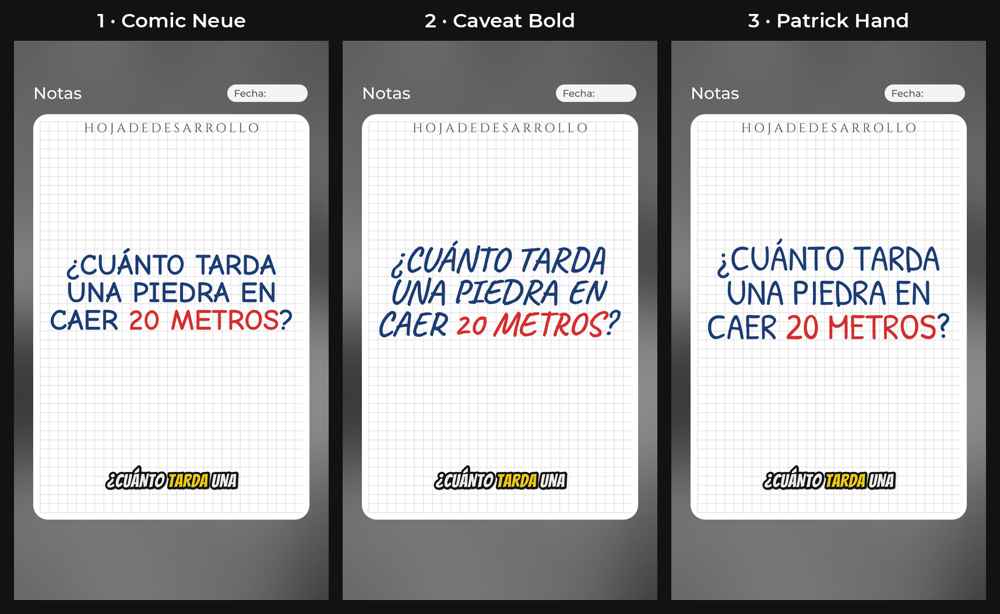
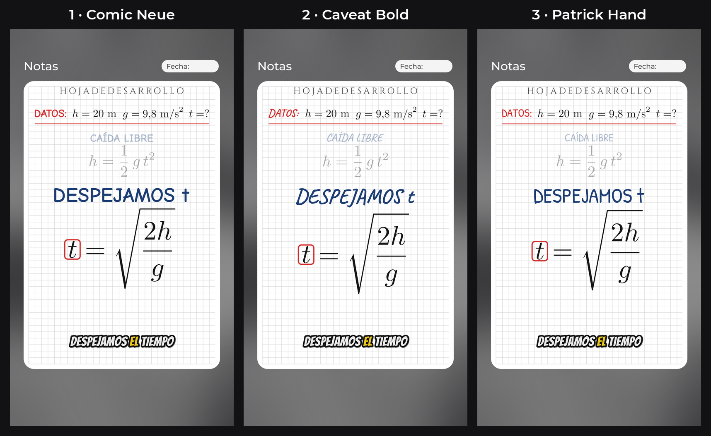

# Propuesta de estilo: "Hoja de desarrollo"

Prueba hecha con el motor de video, imitando tus videos de @tuprofeindustrial.
Todavía **no** es parte del motor: es solo para que decidas.

## 🎬 Video de muestra (animado, con voz y subtítulos)

**[▶ Abrir video_muestra.mp4](video_muestra.mp4)**: en la página que se abre, presiona **"View raw"**
o el botón de descarga para verlo.

- Mismas animaciones del motor: cada dato se subraya cuando la voz lo dice, los términos pasan de una
  ecuación a la siguiente y los pasos anteriores quedan arriba, más chicos.
- Títulos con **Comic Neue** en mayúsculas y subtítulos con **Bangers**: pocas palabras y la que suena en
  amarillo.

## Las 3 letras para títulos

1. **Comic Neue**: cómic técnico, la más clara en el celular (la del video).
2. **Caveat Bold**: escrita a mano, más informal.
3. **Patrick Hand**: escrita a mano, ordenada.

---

Responde en el chat de Kiro con el número de la letra para los títulos (por ejemplo: **"sí, títulos 1"**).
