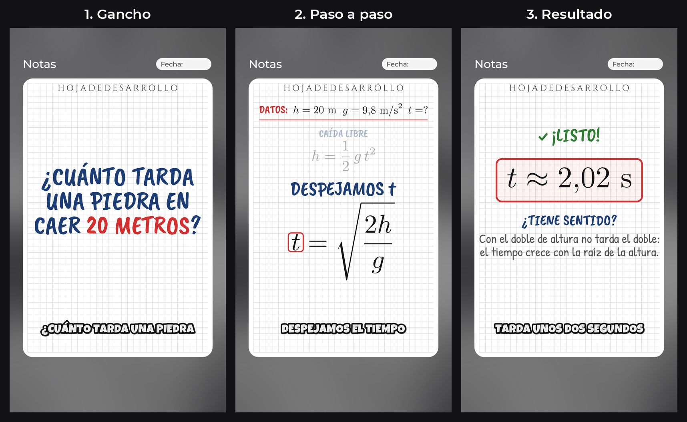
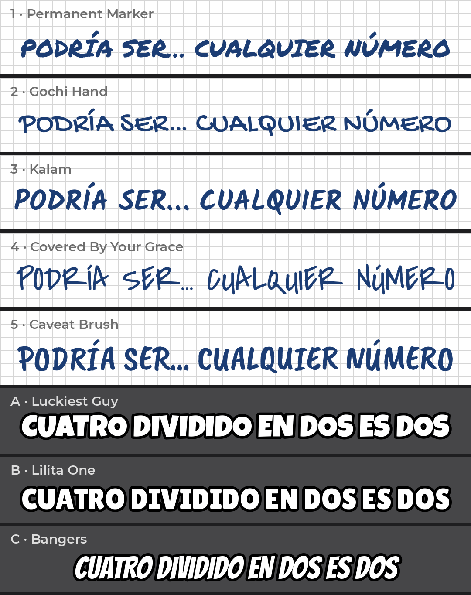

# Propuesta de estilo: "Hoja de desarrollo"

Prueba hecha con el motor de video, imitando tus videos de @tuprofeindustrial.
Todavía **no** es parte del motor: es solo para que decidas.

## 1. Tu estilo en el motor

Gancho, paso a paso y resultado. Títulos con la letra **5** y subtítulos con la letra **A** (ver abajo).

## 2. Opciones de letras

- **Títulos:** de la 1 a la 5. En la prueba se usó la **5 (Caveat Brush)**.
- **Subtítulos:** de la A a la C. En la prueba se usó la **A (Luckiest Guy)**.

Todas son gratuitas y traen tildes y ñ en mayúscula.

---

Responde en el chat de Kiro: **¿apruebas el diseño?** y **¿qué letras prefieres?** (por ejemplo: "títulos 5, subtítulos A").
