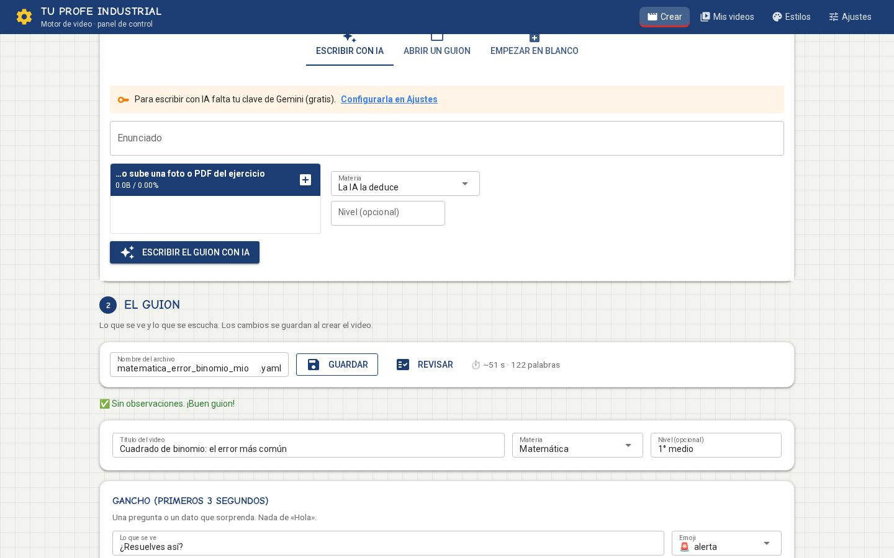
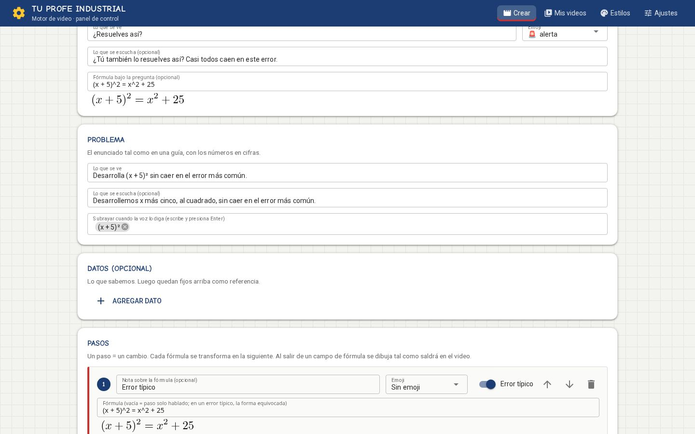
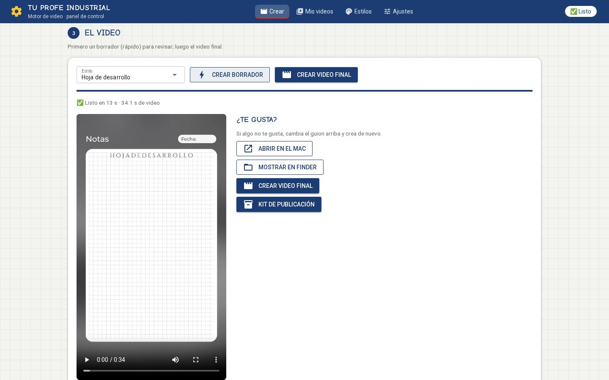
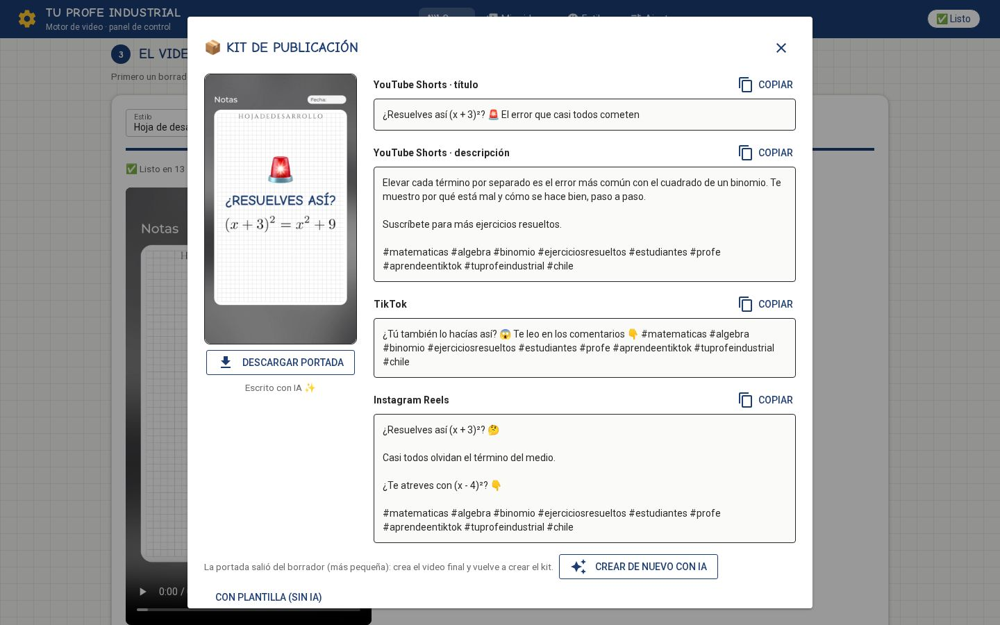
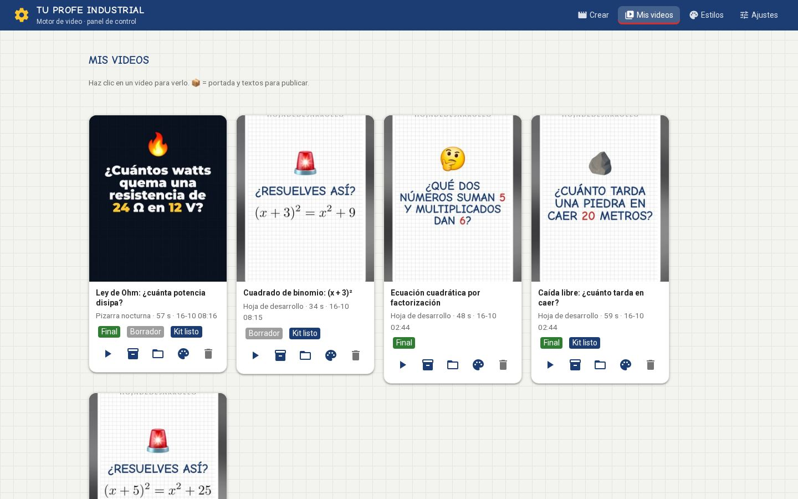
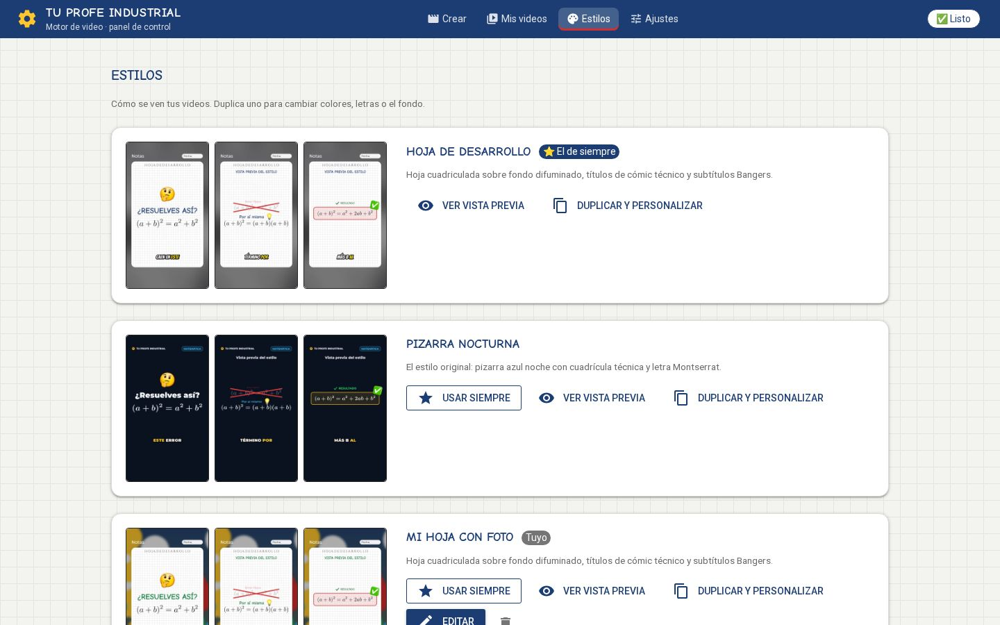
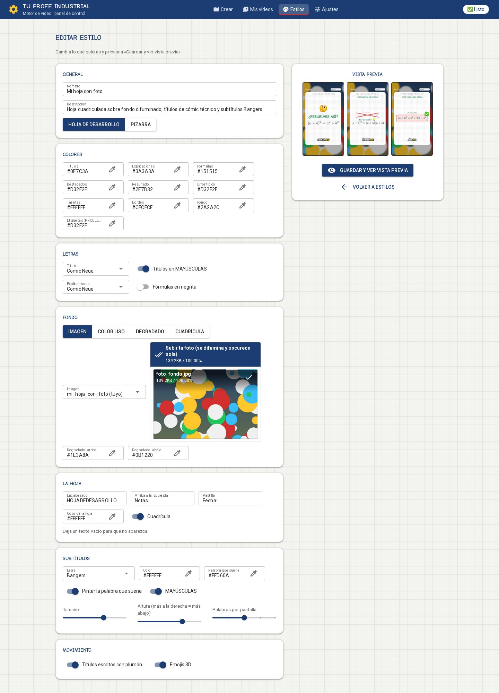
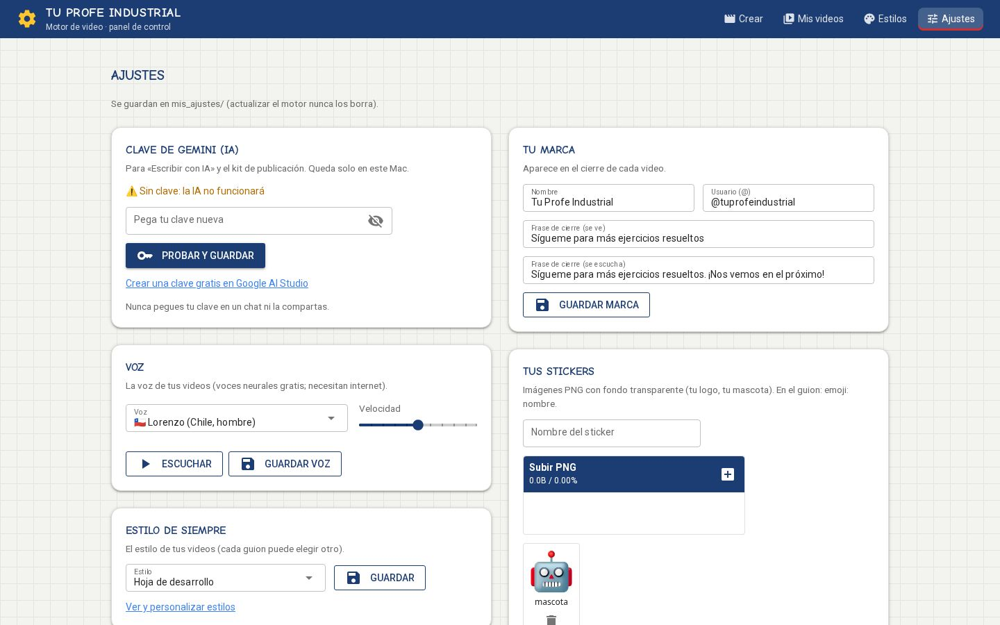

# Capturas del panel de control · motor v0.4

Tomadas en las pruebas automáticas del panel (rama `feat/panel-de-control`). Esta rama es solo para mirar:
no se une a `main`.

1. **Crear · el ejercicio y el gancho**: escribir con IA o subir una foto, y el guion en tarjetas.
   
2. **Crear · los pasos**: cada fórmula se dibuja tal como saldrá; el «error típico» va marcado en rojo.
   
3. **Crear · el video**: borrador con barra de avance y el video ahí mismo.
   
4. **Kit de publicación**: portada y textos para cada red, con botón «Copiar».
   
5. **Mis videos**: miniaturas, estilo y acciones.
   
6. **Estilos**: vista previa de cada estilo (incluido uno propio con foto de fondo).
   
7. **Editar un estilo**: colores, letras, fondo con tu foto, la hoja, subtítulos y movimiento.
   
8. **Ajustes**: clave, voz con muestra, marca, stickers y diagnóstico.
   
